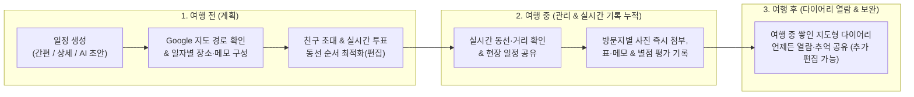

# 🧭 WanderMap 제품 비전 및 핵심 기획 명세서 (Product Vision & Spec)

> **"계획할 때는 가장 직관적인 지도 동선 플래너로, 여행 중에는 실시간으로 쌓이는 기록장으로, 다녀와서는 평생 꺼내 보는 우리만의 여행 다이어리로."**

본 문서는 직관적인 지도 기반 동선 설계와 간편한 블록형 기록 경험을 결합하여, 실시간 그룹 협업과 **여행 다이어리(사진·메모·표·장소 평가) 아카이빙**으로 차별화하는 **WanderMap**의 핵심 기획 방향과 기능 명세를 정의합니다.

---

## 📌 1. 기획 배경 및 문제 정의 (Why WanderMap?)

1. **순수 여행 일정 플래너에 대한 니즈**
   - 숙박·티켓 광고 위주의 복잡한 플랫폼이 아니라, 지도 위에서 번호 핀과 이동 거리를 보며 일자별 코스를 직관적으로 짜고 관리할 수 있는 깔끔한 일정 도구가 필요합니다.
2. **‘여행 전(계획)’에만 쓰이고 버려지는 기존 플래너의 한계**
   - 기존 일정 도구들은 여행 출발 전 동선을 짤 때만 사용되고, 정작 여행 중이나 여행이 끝난 뒤에는 메신저 사진첩·SNS·메모장으로 기록이 뿔뿔이 흩어집니다.
3. **WanderMap의 해답: [계획(Plan)] + [실시간 관리 및 다이어리 누적(Manage & Diary)]의 일원화**
   - 여행 전에는 친구들과 지도 위에서 동선을 계획하고, **여행 중에는 일정 페이지에 접속해 방문지마다 사진·메모·평가를 바로 남기며 기록을 차곡차곡 쌓고**, 여행이 끝난 뒤에는 그렇게 완성된 **‘지도 기반 여행 다이어리’**를 언제든 꺼내 보고 추억합니다.

---

## 🛠️ 2. 양대 핵심 축: [계획 (Plan)] & [관리 (Manage)]

### A. 여행 계획 (Planning) — 군더더기 없는 지도 동선 설계

1. **3가지 방식의 유연한 여행 일정 생성**
   - **간편 생성**: 목적지와 여행 날짜(출발일~종료일)만 선택해 1초 만에 일정 보드 생성
   - **상세 생성**: 여행 제목, 목적지, 세부 일정을 직접 지정하여 생성
   - **AI 초안 자동 생성 (보조)**: 원하는 여행 분위기나 키워드를 입력하면 Gemini가 일자별 추천 코스 초안을 자동으로 구성

2. **Google Maps 기반의 시각적 경로 & 거리 확인**
   - 국내외 모든 여행지를 제약 없이 커버하기 위해 **Google Maps(구글 지도)** 기반으로 동작합니다.
   - 일자별 방문지가 지도 위에 순서 번호 마커(`1` ➔ `2` ➔ `3`...)와 점선 경로로 표시되며, 장소와 장소 사이의 직선/이동 거리(`3.4km`, `492m` 등)를 직관적으로 확인하며 동선이 꼬이지 않게 계획합니다.

3. **확장형(Compact ↔ Expanded) 일자별 여행지 리스트**
   - **기본 뷰 (Compact List)**:
     - 우측 패널에서 `Day 1`, `Day 2` ... `마지막날` 탭별로 삽입된 여행지와 메모를 한눈에 파악할 수 있는 **심플하고 깔끔한 타임라인 리스트**로 제공합니다.
     - 타임라인 세로 연결선 위에 장소 간 이동 거리가 표시되며, **`편집 ↔ 완료` 모드 전환**을 통해 간편하게 장소를 삭제(`⊖`)하거나 위아래 순서를 변경(`↕`)할 수 있습니다.
     - 하단의 **`[+ 장소 추가]`** 및 **`[+ 메모 추가]`** 버튼으로 실제 장소뿐 아니라 이동편·체크인 시간 등 일정 메모도 자유롭게 배치합니다.
   - **확장 뷰 (Expanded Detail View)**:
     - 리스트 박스를 넓게 펼치거나 개별 장소를 클릭하면, 장소의 세부 정보, 동행자 찬반 투표 현황, 마크다운·표 메모, 그리고 **사진·평가 다이어리 기록**까지 세밀하게 확인하고 작성할 수 있는 상세 모드로 전환됩니다.

---

### B. 여행 관리 및 기록 (Management & Travel Diary) — WanderMap만의 핵심 차별화

1. **동행자 초대 및 실시간 공동 관리**
   - 고유 초대 링크/코드를 통해 친구들을 여행 일정에 초대하여 함께 지도를 보고, 장소를 추가·편집하거나 실시간 찬반(👍/👎) 투표로 동선을 함께 확정합니다.
   - 계획 단계뿐 아니라 실제 여행 중에도 모든 멤버가 동일한 최신 동선과 메모를 실시간으로 공유하며 일정을 관리합니다.

2. **여행 중 실시간으로 쌓이는 포토 다이어리 & 장소별 평가**
   - **여행 중(On-Trip) 실시간 기록 누적**:
     - 여행이 끝난 뒤에만 몰아서 적는 것이 아니라, **여행 중에도 해당 일정 페이지에 수시로 접속해 각 일자(`Day 1`, `Day 2`...)나 방문지(예: 남산타워, 도톤보리)에 방금 찍은 사진을 첨부하고 현장 메모와 감상을 바로 남기며 기록이 자연스럽게 쌓입니다.**
   - **우리만의 솔직한 장소 평가 (Rating & Review)**:
     - 광고성 블로그 리뷰가 아니라, 우리가 직접 방문한 맛집·카페·명소·숙소에 대한 **별점/만족도와 한줄 평가**를 그 자리에서 기록합니다.
   - **여행 후(Post-Trip) 완성된 다이어리 열람 및 회고**:
     - 여행 중에 차곡차곡 쌓인 사진·메모·평가가 동선 지도와 결합되어, 여행 후에는 언제든 다시 열어보고 추억할 수 있는(필요시 추가 정리도 가능한) **‘우리만의 지도형 여행 다이어리 북’**이 됩니다.

3. **누구나 쉽게 쓰는 블록형 마크다운 & 원클릭 표(Table) 에디터**
   - **직관적인 마크다운 메모**:
     - 제목(`#`), 체크리스트(`[]`), 글머리 기호(`-`), 굵게(`**`) 등 기본 마크다운 서식을 지원하여 준비물 체크리스트나 예약 번호, 이동 팁을 깔끔하게 정리할 수 있습니다.
   - **타이핑이 필요 없는 원클릭 `[+ 표 삽입]` (Interactive Table)**:
     - 복잡한 마크다운 표 문법(`|---|---|`)을 직접 타이핑할 필요 없이, **`[+ 표 삽입]` 버튼 클릭 한 번으로 즉시 표 블록이 생성되고 각 셀(Cell) 안을 클릭해 바로 내용을 입력**할 수 있습니다.
     - 행/열 추가·삭제 버튼만으로 **여행 경비 정산표, 기차/항공편 시간표, 준비물 분담표** 등을 PC와 모바일 어디서나 손쉽게 작성하고 한눈에 볼 수 있습니다.

---

## 🔄 3. 사용자 경험 흐름 (End-to-End Lifecycle)

---

## 📋 4. 화면 설계 핵심 원칙 (UI/UX Principles)

1. **직관적인 동선 타임라인 + 초간편 블록 기록 결합**:
   - **한눈에 읽히는 동선**: 번호 마커, 세로 점선, 장소 간 거리(`km`/`m`) 뱃지, `편집 ↔ 완료` 토글, `장소 추가 / 메모 추가`의 직관성을 살립니다.
   - **무마찰(Frictionless) 기록**: 일자(`Day 1`)나 장소 카드를 열면 **클릭 한 번으로 마크다운 메모를 적고, `[+ 표 삽입]`으로 셀 안에 바로 타이핑하며, 사진을 툭툭 올리고, 별점·한줄평을 즉시 남기는 간편한 기록 경험**을 제공합니다.
2. **PC · 모바일 완벽히 일관된 반응형 UI/UX**:
   - 여행 전(주로 **PC/태블릿**)과 여행 중 현장 기록(주로 **모바일**), 여행 후 열람(PC/모바일 모두) 전 과정에서 **동일한 컴포넌트 구조와 조작 방식(탭해서 펼치고, 바로 사진·표·메모·평가를 추가하는 일관된 경험)**을 유지하도록 설계합니다.
3. **설명문 최소화 & 직관적인 타이포그래피**:
   - 불필요한 가이드 텍스트를 줄이고, 큼직하고 선명한 글씨와 아이콘/위치만으로 기능이 즉각 이해되도록 설계합니다.
